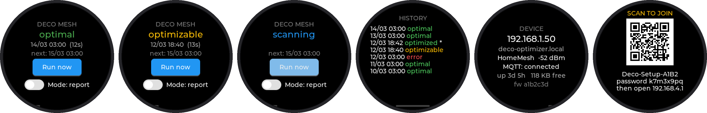
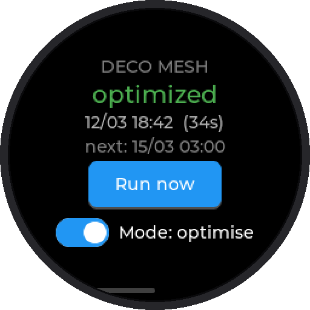
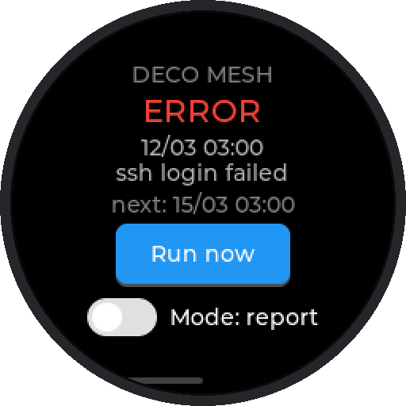
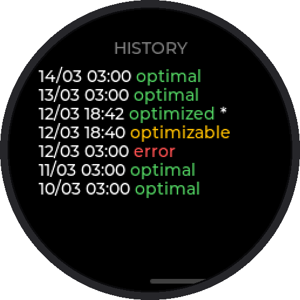
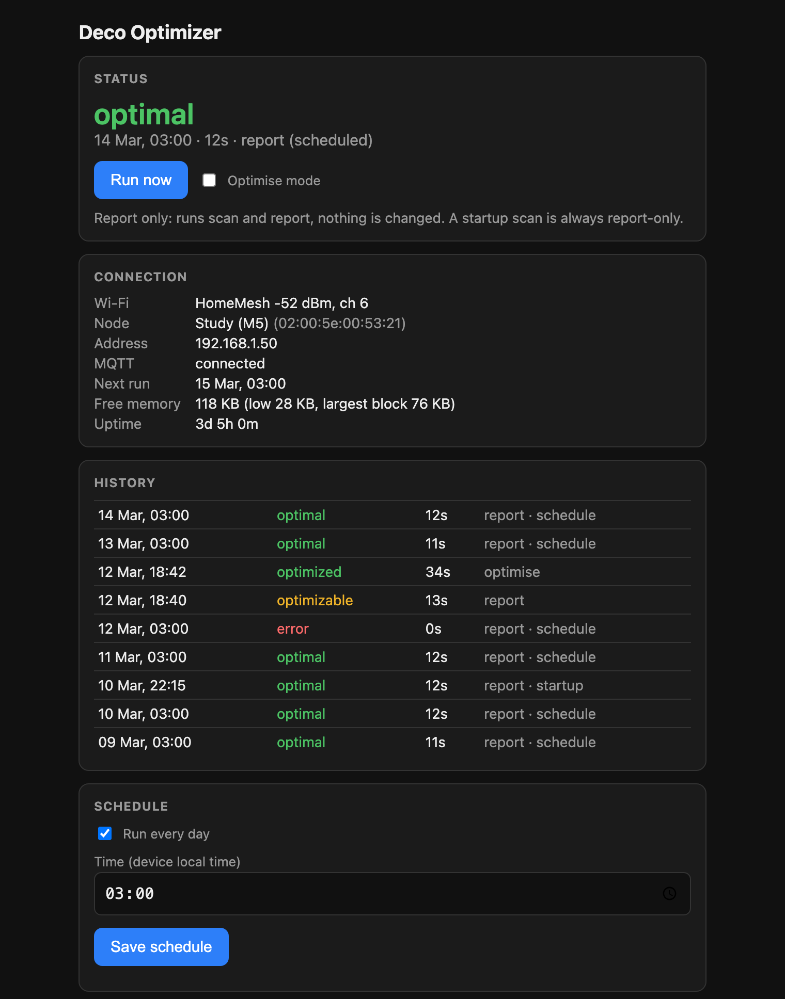
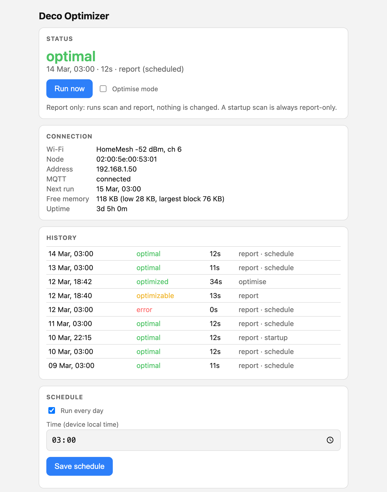
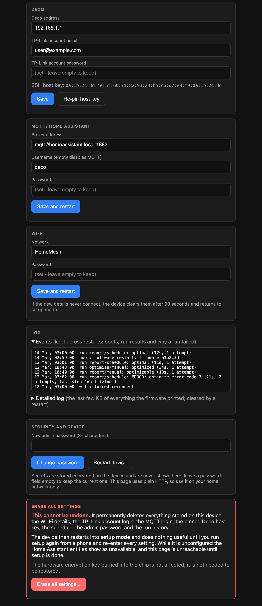
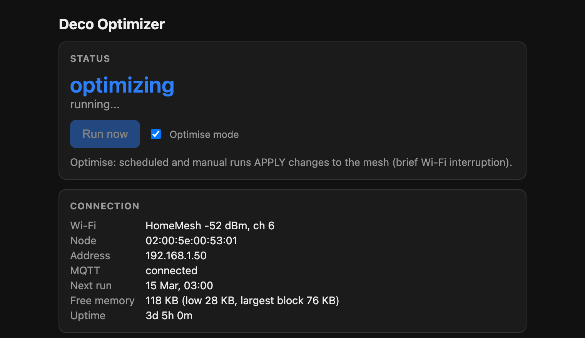
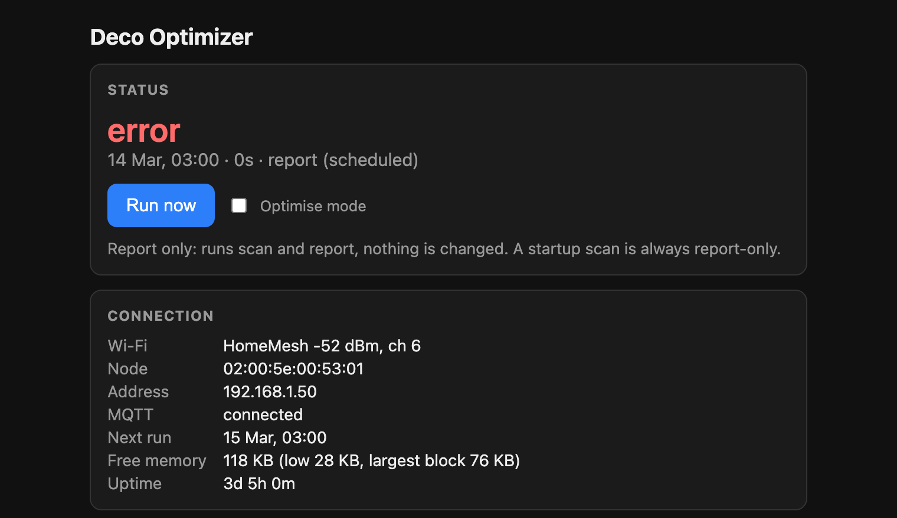
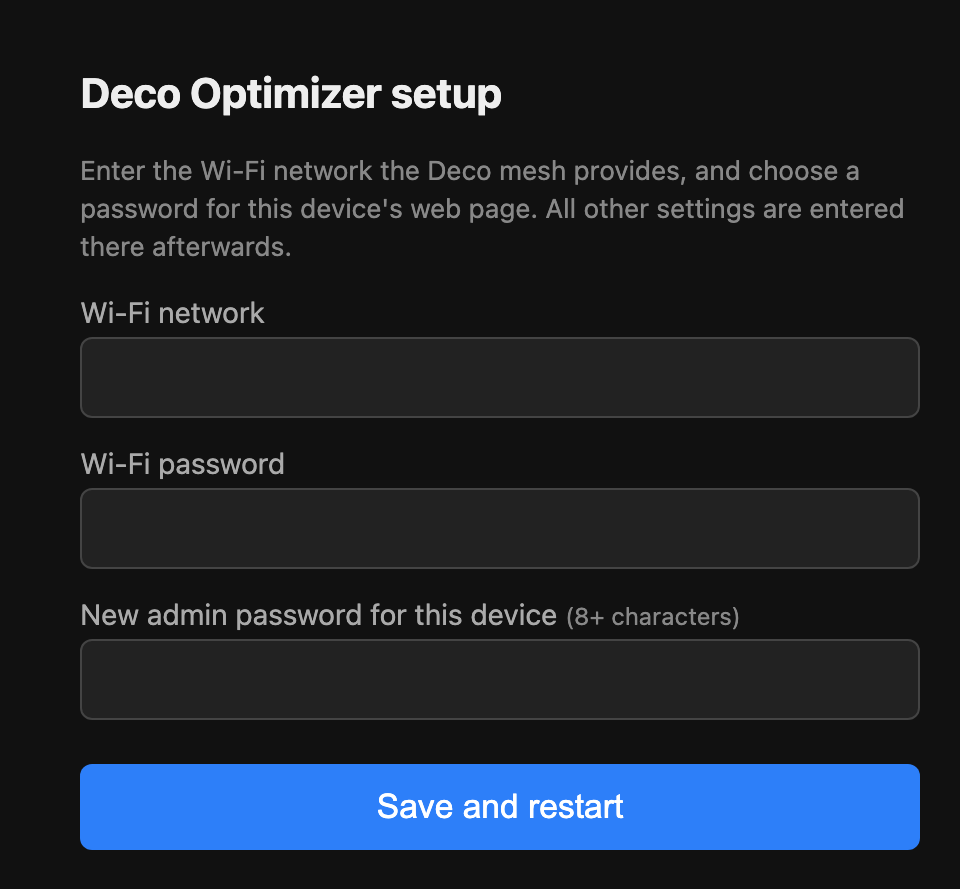

# Deco Optimizer

Runs the TP-Link Deco mesh **network optimization** (scan, then optimize if the Deco says it will help) from an
ESP32-C3 with a 1.28" round touch display (Guition ESP32-2424S012: GC9A01 + CST816S), on demand or on a daily schedule.
Status and controls are on the display, on a small web page, and in Home Assistant over MQTT.

The Deco mesh has no local API for this feature. The Deco app does it over an SSH tunnel into the master Deco, speaking a
binary protocol ("TMP") to a service on the Deco's loopback interface; this project reproduces that. The protocol notes and a
Python reference implementation are in [Zoogara/deco-network-optimize](https://github.com/Zoogara/deco-network-optimize).

## Features
- Scan / optimize via SSH direct-tcpip to `127.0.0.1:20002` on the Deco (libssh2 on mbedTLS; the Deco's 512-bit RSA host key
  is pinned on first use).
- Touch UI: status page, swipeable history, Run now, report-only / optimise switch.
- Daily schedule (SNTP, POSIX timezone in `main/config.h`). A report-only scan always runs once after boot, and a reboot never optimises.
- Screensaver: after 5 minutes without a touch the screen shows a short burst of "snow" and the backlight turns off. A touch wakes it (that touch is
  not passed on to the buttons underneath), and so does every scan or optimise run, scheduled or not. Set `CONFIG_DECO_SCREENSAVER_TIMEOUT_S` to change the time, or `0` to disable.
- Home Assistant MQTT discovery (state, last/next scan, optimise switch, run button), with availability.
- Wi-Fi tuned for a multi-node mesh: joins the strongest node, pings the gateway before each run and moves off a node
  that is not passing traffic.
- First-run setup: the device starts its own access point (QR code on screen) and a captive portal asks for the Wi-Fi network and a
  web admin password. Everything else is set on the web page. Holding BOOT for 5 s while running re-enters setup.

## Screenshots
Generated from the real UI code and web page with **invented data** (see [tools/screenshots](tools/screenshots)); nothing here is from a real network.

Left to right: status (optimal), status (optimizable), scanning, history, the device page, and the first-run setup screen. Swipe left on the status screen for the
history, and again for the device page (the device's IP address, hostname, Wi-Fi network and signal, MQTT state, uptime, free memory and firmware version).
A `*` in the history marks a run made in optimise mode. The coloured word is the Deco's verdict from the last scan.

<table><tr>
<td> Optimise mode on</td>
<td> An error, with its reason</td>
<td> History</td>
</tr></table>

The web page (dark and light follow the browser):

<table><tr>
<td></td>
<td></td>
</tr></table>

Settings (below the schedule on the same page). Passwords are write-only: the fields show "set" and are never filled in.

<table><tr>
<td> While an optimise is running</td>
<td> After a failed run</td>
</tr></table>

The first-run setup page that a phone opens from the setup access point:

## First-run setup
A new device (or one whose Wi-Fi details were cleared) starts its own Wi-Fi network, **`Deco-Setup-XXXX`** (the last four hex digits come from the
device's MAC address), and runs a captive portal that asks only for the Wi-Fi network and a web admin password. Everything else is entered afterwards on the web page.

**With a screen**
1. Power it up. The screen shows **SCAN TO JOIN**, a QR code, the network name and a random password.
2. Scan the QR code with a phone camera to join, or join `Deco-Setup-XXXX` by hand with the password shown.
3. The setup page opens by itself. If it does not, browse to `http://192.168.4.1`.
4. Pick or type your Wi-Fi network, enter its password and choose an admin password (8+ characters), then **Save and restart**.

**Headless** (no screen, so no QR code and no on-screen password)
1. The setup network's password is the one you set in the build, `CONFIG_DECO_SETUP_AP_PASSWORD` (see [Headless build](#headless-build-no-screen)).
2. Power it up and look for `Deco-Setup-XXXX` in your phone's Wi-Fi list. The serial log prints the exact name too (`SETUP MODE: join the Wi-Fi network ...`).
3. Join it with the build password, then follow steps 3 and 4 above.

**After saving**, the device restarts and joins your Wi-Fi. If the new details never produce a connection within 90 seconds it clears them and returns to setup, so a typo cannot lock you out.
Then open `http://deco-optimizer.local/` (the first lookup can take about 5 seconds on macOS), or the device's address from your router's client list or, on a headless build, from the serial log.
Sign in as `admin` with the password you chose, and enter the TP-Link account email and password, the Deco's address and, if you use it, the MQTT broker.

**Back into setup later:** hold the reset button (the board's BOOT button by default, `CONFIG_DECO_RESET_BUTTON_GPIO`) for 5 seconds while the firmware is running. That clears only the Wi-Fi
details. Or use **Erase all settings** on the web page, which wipes everything. A build with the button disabled (`-1`) can only be returned to setup from the web page or by reflashing.

## Home Assistant
With MQTT configured, one device, **Deco Optimizer**, appears through MQTT discovery (default prefix `homeassistant`):

| Entity | What it is |
|---|---|
| Network optimisation (sensor) | `optimal`, `optimizable`, `optimized`, `error`, or live progress (`scanning`, `optimizing`, ...). Attributes: `duration_s`, `mode`, `trigger` (`manual`, `schedule`, `startup`), `detail`. |
| Last scan, Next scheduled scan (sensors) | Timestamps. |
| Optimise mode (switch) | Off = report only. |
| Run scan now (button) | Starts a run in the current mode. |

Topics are under `deco_optimizer/<id>/` (`state`, `attributes`, `last_run`, `next_run`, `mode`, `availability`; commands on `mode/set` with `ON`/`OFF` and `run/set` with `PRESS`),
where `<id>` is the last three bytes of the MAC address in hex. Availability uses a retained last-will message, so entities show "unavailable" if the device drops off MQTT, which also
happens briefly during a Deco scan (the scan disturbs Wi-Fi clients, this device included).

## Logs
Two logs, chosen so that they cannot wear out the flash or starve the RAM the SSH handshake needs. Both are on the web page under **Log**.
- **Events** are kept in the encrypted NVS and survive restarts: each boot with its reset reason and firmware version, each run's outcome (with the failure reason and the step
  it reached, e.g. `run optimise/manual: ERROR: optimize error_code 3 (21s, 2 attempts, last step 'optimizing')`), forced Wi-Fi reconnects and node moves, and self-heal reboots.
  The last 24 are kept, one small write per event, at most 30 an hour.
- **Detailed log**: the last 4 KB of everything the firmware prints, held in RAM (so it costs no flash wear) and lost on restart.

The Deco acknowledges each scan or optimise request with an `error_code`; a non-zero value is now reported as the reason for the failed run instead of being ignored.

## Security notes
- All settings and secrets (Wi-Fi, TP-Link login, MQTT login, admin password, pinned host key) are stored in one blob in an
  **encrypted NVS** partition. The key is derived from an HMAC key generated inside the chip and burned to eFuse BLOCK_KEY5
  (`HMAC_UP`) on first boot. **This is irreversible** and uses one of the six key blocks. Secure boot and flash encryption are not enabled,
  so someone who can reflash the chip can still ask it to decrypt; the protection is against reading secrets from a flash dump.
- The web page is **plain HTTP** with Basic auth (user `admin`). Use it on a trusted network only. Secret fields are write-only.
- The TP-Link cloud account password is what the Deco accepts for SSH, so treat the device accordingly.
- "Erase all settings" on the web page wipes everything and returns the device to setup mode.

## Build
ESP-IDF v5.3.x. Chip-specific defaults live in `sdkconfig.defaults.<target>`:

    . $IDF_PATH/export.sh
    idf.py set-target esp32c3        # or esp32s3, esp32c6, ...
    idf.py build flash

`sdkconfig.defaults*` apply only when `sdkconfig` is first generated, so delete `sdkconfig` after changing them.
Options are under `idf.py menuconfig` -> "Deco Optimizer". After flashing the ESP32-2424S012, power-cycle it if the new firmware does not start.

### Headless build (no screen)
Enable **Headless build** (`CONFIG_DECO_HEADLESS`) and set **Setup access point password** (`CONFIG_DECO_SETUP_AP_PASSWORD`, 8-63 characters;
the build fails without it, because there is no screen to show a random one on). The display, touch input and LVGL are replaced by
stubs, and status and control are on the web page, over MQTT/Home Assistant and in the serial log. Headless saves about 330 KB of flash and, measured on an ESP32-C3,
roughly 66 KB of free heap (186 KB free before an SSH session instead of 120 KB; the low point during the handshake is 96 KB instead of 29 KB).
For example, with an overlay file:

    printf 'CONFIG_DECO_HEADLESS=y\nCONFIG_DECO_SETUP_AP_PASSWORD="choose-something"\n' > headless.defaults
    idf.py -B build-headless -DIDF_TARGET=esp32c3 -DSDKCONFIG=build-headless/sdkconfig \
        -DSDKCONFIG_DEFAULTS="sdkconfig.defaults;headless.defaults" build

The display and touch libraries are still downloaded and compiled in a headless build (ESP-IDF 5.3's component manager cannot make dependencies depend on a project option), but nothing links them.
Set **Setup-reset button GPIO** (`CONFIG_DECO_RESET_BUTTON_GPIO`, `-1` to disable) to match your board's button.

### Chip support
| Chip | Status | Notes |
|---|---|---|
| ESP32-C3 | Tested on hardware, with screen and headless | The reference board. |
| ESP32-S3, ESP32-C6 | Headless build compiles; not run | Have the HMAC peripheral, so the encrypted-NVS design applies unchanged. The screen code is specific to the GC9A01/CST816S board and its pins (`display.c`). |
| ESP32-S2 | Not built | Has HMAC; no USB-serial-JTAG, so the console is UART. 2.4 GHz Wi-Fi, similar RAM to the C3. |
| ESP32 (classic) | Not built | **No HMAC peripheral**: the NVS encryption scheme used here is unavailable, so secrets would be stored unencrypted unless you set up flash encryption and the `nvs_keys` scheme. Plenty of RAM. |
| ESP32-C2 | Not recommended | Probably too little RAM for the SSH handshake (about 78 KB transient) next to Wi-Fi, and no HMAC. |
| ESP32-C5 | Not built | Needs a newer ESP-IDF than 5.3. |
| ESP32-H2, ESP32-P4 | No | No Wi-Fi. |

## Layout
`main/deco.c` (SSH + TMP client), `tmp_proto.c` (framing), `wifi.c` (mesh-aware station), `settings.c` (encrypted config),
`provision.c` (setup AP + portal), `web.c` + `web/index.html`, `mqtt.c`, `ui.c`, `display.c`, `history.c`.
`tools/screenshots` renders the screenshots above on a computer.

## Known limitations
- Free RAM is tight with the screen: the SSH handshake briefly needs about 78 KB of the roughly 120 KB that is free when idle, which is why the
  web server is HTTP only. A headless build has roughly 66 KB more.
- The Deco's own scan briefly drops Wi-Fi clients, including this device, so Home Assistant entities flicker "unavailable" during scans.

## Licence
MIT, the same as the protocol notes and Python example: see [LICENSE](LICENSE). Third-party components keep their own licences
(libssh2: BSD-3-Clause; LVGL and cJSON: MIT; ESP-IDF, mbedTLS and mDNS: Apache-2.0).
